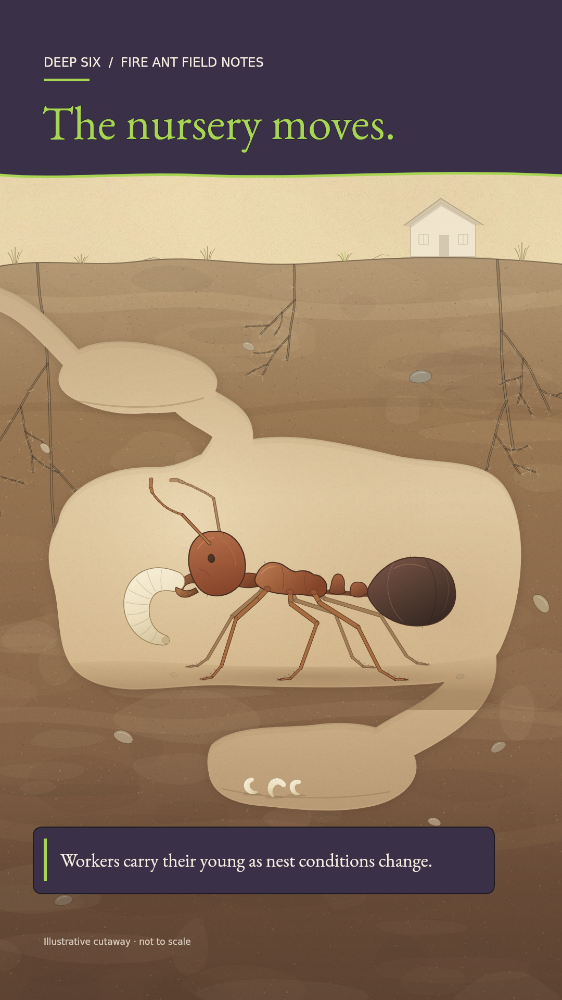

# Deep Six colors

**New:** [Compare this original with three different styles](style-options/review.md). No style selected yet.

**The ad's lime green, deep purple, near-black and warm white now frame the illustration.** These colors are saved as the shared palette for future videos.

[Reference ad](../../../brand/fun-fact-friday-spider.png) · [Earlier version](renders/frame-v1.png)

The headline and accents use lime; the header and explanation panel use deep purple. The original insect and nest drawing remain intact.

**Checks passed:** repeatable 1080×1920 render, original illustration preserved, approved audio intact. [Check record](renders/frame-v2.checks.json).

Current stage: review this branded look, then make the short moving test.
