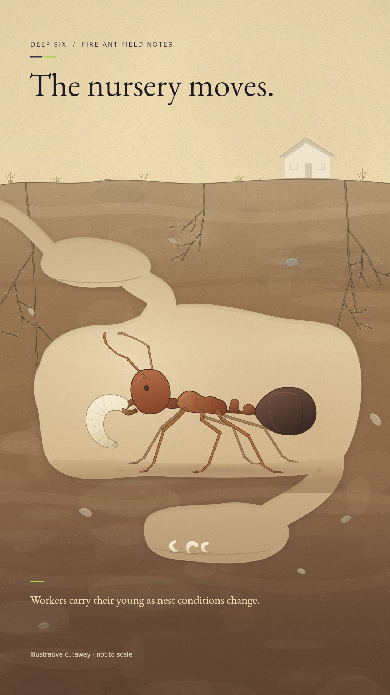

# First illustration

**Latest candidate: [version 2 with Deep Six ad colors](review-v2.md).** Drew requested the ad's branding colors after this first version.

**Review the look of the ant, nest and illustrated detail.** Next comes a 10–15-second moving test with your approved Tyler narration.

## Built for reuse

Astra created this drawing code at ultra effort. The settings, original code and review record are saved together. Rendering runs locally; matching inputs reuse this exact frame. Your stated feedback will guide the next version.

**Checks passed:** 1080×1920, repeatable image, approved audio unchanged. First local render: about one second. [Check record](renders/frame-v1.checks.json).

Current stage: **waiting for your artwork review**. Motion, audio excerpt timing and final captions come next. [Production flow](../../README.md).
