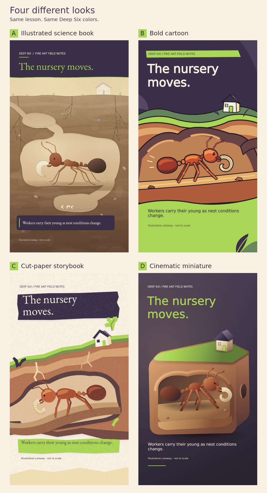

# Choose the illustration style

**Selected: C — Cut-paper storybook.** Drew chose C; the short moving preview is being built.

The comparison below preserves all four options. Unchosen styles are not recorded as dislikes.

- **A — Illustrated science book:** warm, detailed and natural. [Full size](../renders/frame-v2.png).
- **B — Bold cartoon:** thick outlines and punchy shapes. [Full size](cartoon/renders/frame-v1.png).
- **C — Cut-paper storybook:** textured paper layers and handmade shapes. [Full size](paper/renders/frame-v1.png).
- **D — Shaded miniature:** rounded forms, lighting and depth. [Full size](miniature/renders/frame-v1.png).

C is approved as an illustration. The moving test will have a separate review with the approved Tyler narration.

## Saved for the automation

Astra at ultra effort wrote the three new styles as reusable drawing code. Each has its own settings and pending review record. Your choice and stated feedback will guide the next version; unchosen styles do not count as dislikes.

## Checked

All three render at **1080×1920** and reproduce exactly. The original artwork, approved audio and frozen whiteboard files are unchanged. D uses drawn shading to suggest depth. Motion and audio timing are still ahead. [Check results](checks.json) · [Saved choices](options.json).
