<!-- d6-current:start -->
**Liked sources saved.**

1. **First: [Fire Ant Frequently Asked Questions](https://fireant.tamu.edu/manage/faq/)** — A drought can hide fire-ant activity without eliminating the colony. A quiet-looking lawn is not proof that the ants have disappeared.

2. **Queued: [Tawny Crazy Ants: A Texas-Size Problem](https://extensionentomology.tamu.edu/wp-content/uploads/2025/03/tawny-crazy-ants-a-texas-size-problem.pdf)** — Inspect incoming landscaping materials before moving them onto your property: people can transport tawny crazy ants with plants, mulch and other materials.

3. **Queued: [Identifying household ants](https://citybugs.tamu.edu/factsheets/household/ants-house/ent-2013/)** — An ant's running speed does not identify it by itself. Observe worker-size differences and activity patterns to gather useful identification clues.

4. **Queued: [Biology](https://fireant.tamu.edu/learn/biology/)** — Fire-ant mating flights help explain new colonies: winged reproductives leave, mate, and fertilized queens start nests after landing.

Next research: cockroaches.

Hooks are on hold while we design research.
<!-- d6-current:end -->

# Deep Six board

Newest on top.

---

### 2026-10-19 20:46 · Model test: Astra and Sol make our videos

**Update after Drew watched: Astra's clips are bad; Sol's Test 3 is the better one.** My first read below was wrong.

Each model made the same 13 seconds ("Those young ants ... waterlogged soil") from scratch, without seeing my version. They are on your Desktop:

- **Deep Six - Model Test 1 Opus**: mine, from the finished video.
- **Deep Six - Model Test 2 Astra**: 9 minutes, 15 shots.
- **Deep Six - Model Test 3 Sol**: 8 minutes, 9 shots.
- **Deep Six - Model Test 4 Astra Full Flow (first half)**: Astra planned and made the ending by itself.

**Heads-up:** your ChatGPT Codex usage limit ran out during these tests. It resets **October 26 at 11:01 AM**. Astra and Sol share that one limit.

**Astra's version, moving:**

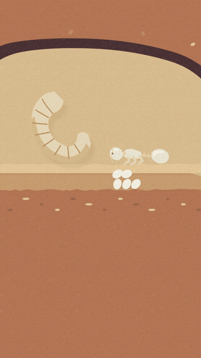

**Opus (mine), beat by beat:**

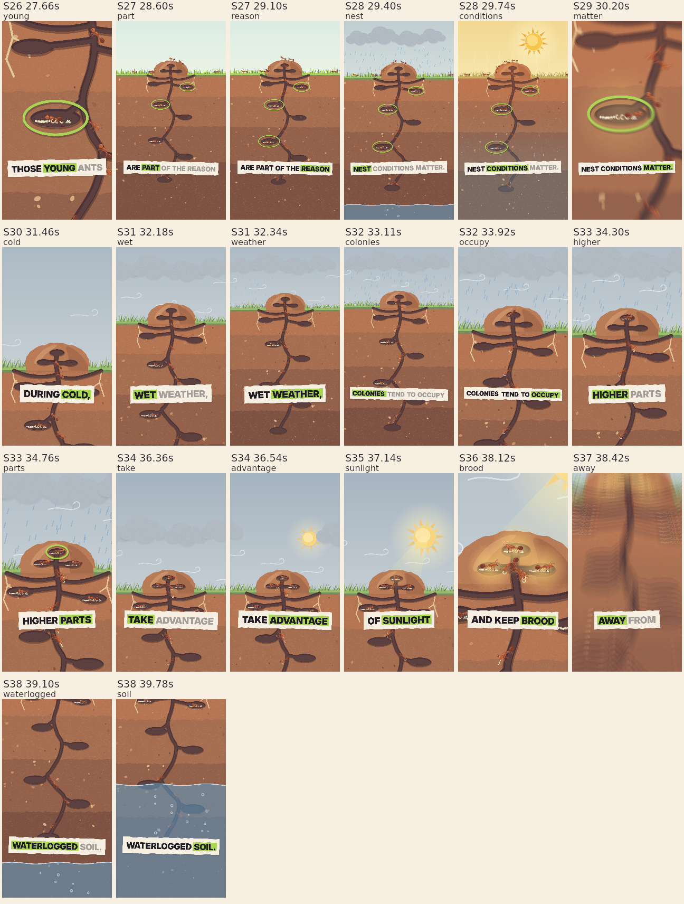

**Astra, beat by beat:**

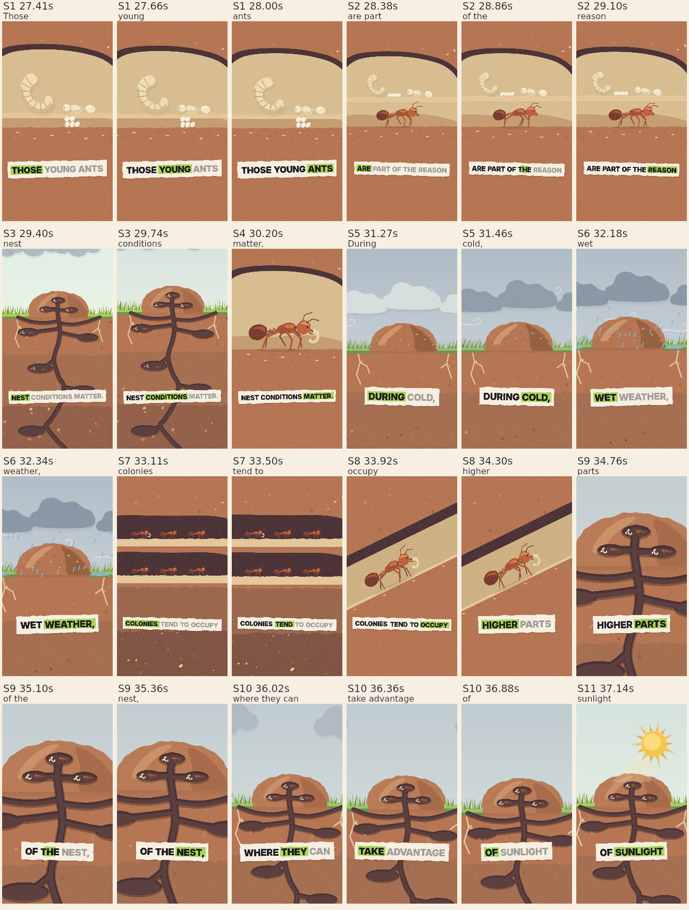

**Sol, beat by beat:**

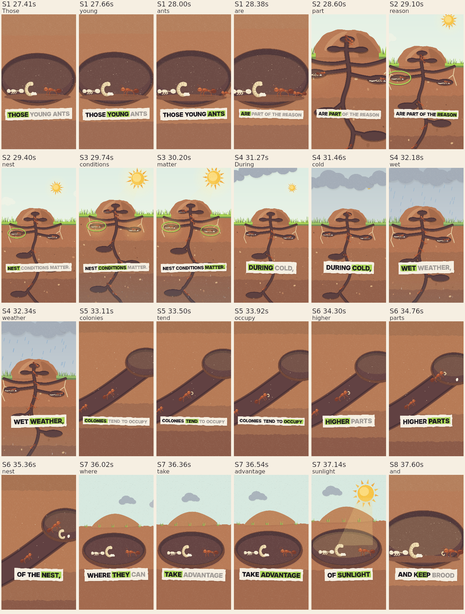

### 2026-10-19 19:20 · Full video v2: fire ants in a drought

**The full fire-ant video is done: 79 seconds, 76 shots, every phrase drawn as it is spoken.**

It is on your Desktop: **Deep Six - Fire Ants Full v2.mp4**. Play it there for sound.

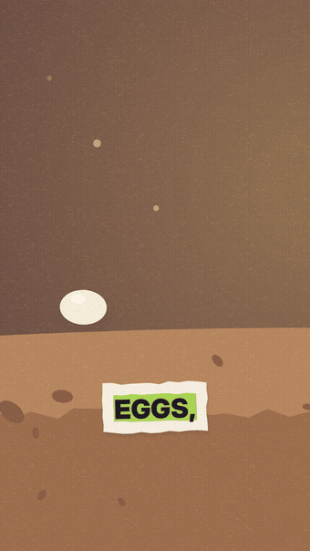

**What happens:**

- **0 to 9 s:** your approved hook, unchanged.
- **9 to 16 s:** inside the nest: busy chambers, workers walking outside, a nursery deep underground.
- **16 to 27 s:** eggs, larvae and pupae up close; an egg hatches and grows into an adult.
- **27 to 46 s:** cold and wet: brood carried up into the warm mound while the deep soil floods. Hot and dry: brood carried down to the cool, moist deep chambers.
- **46 to 58 s:** workers carry the brood; a lime picture frame follows the nursery around the nest; one pinned room gets a big X.
- **58 to 68 s:** the mound doesn't show where the young are; the busy colony hides under a quiet lawn.
- **68 to 79 s:** a homeowner, a missing mound, a magnifier and a gauge with no reading.

**Every beat, in order:**

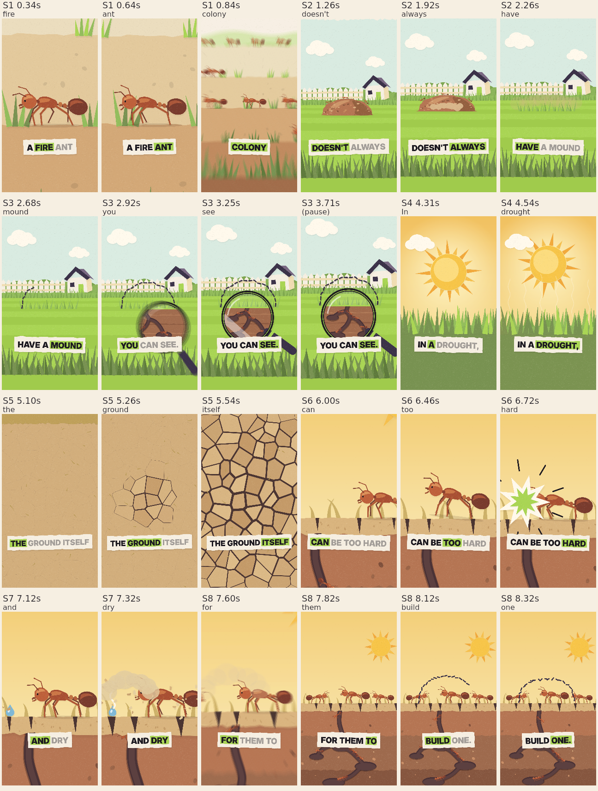

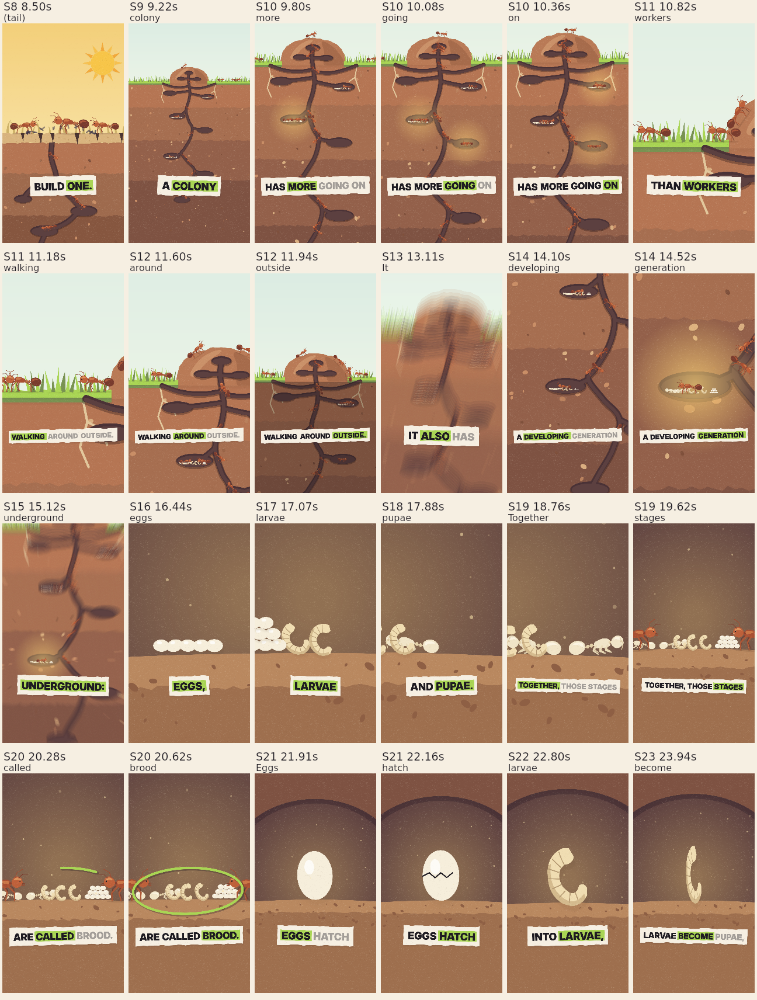

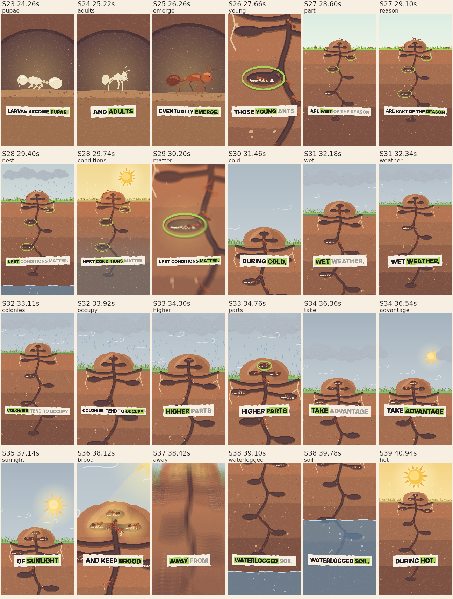

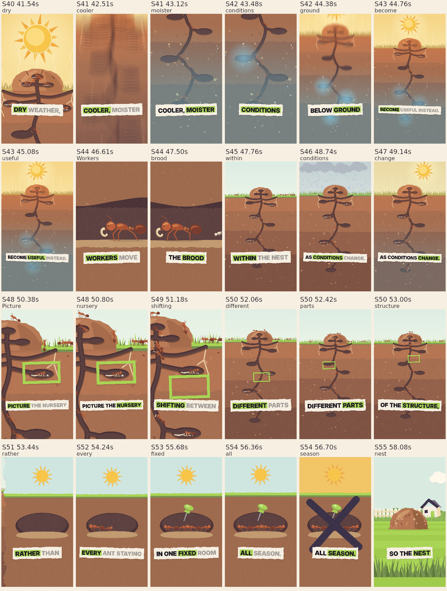

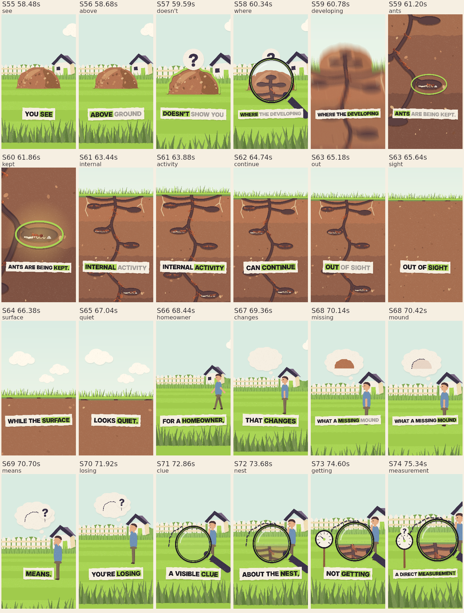

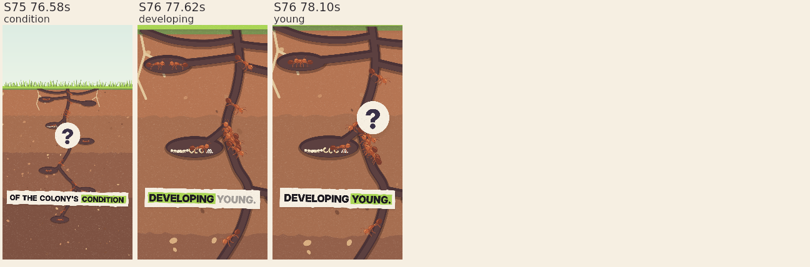

### 2026-10-19 18:03 · Hook animation v1: fire ants in a drought

**First try at the hook: 8.8 seconds, 8 shots, a new action every quarter to half second.**

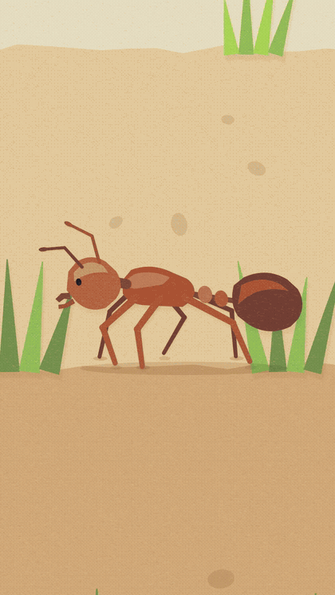

[Play it with sound](01-content/animation/episodes/D6-6c917b49743b/hook/renders/hook-v1.mp4)

**Every phrase gets its own picture, timed to the word:**

- **"A fire ant"**: a big worker walks across the screen.
- **"colony"**: the camera pulls back to dozens of ants.
- **"doesn't always have"**: a mound pops up, then squashes flat.
- **"a mound you can see"**: a dashed outline marks it; a magnifier shows ants still underground.
- **"In a drought"**: the sun drops in and the grass turns straw.
- **"the ground itself"**: cracks race across dry soil.
- **"can be too hard"**: the ant bites the ground. Clank.
- **"and dry"**: dust blows and the last drop dries up.
- **"for them to build one"**: a dashed mound appears and falls apart. The colony is still below.

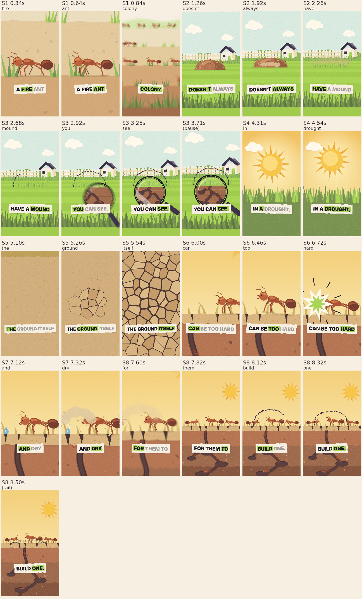

**How the agent makes it**

1. Measure when each word is said.
2. Director prompt: one picture per phrase, landing on its word.
3. Animator prompt: turn those shots into drawing code.
4. Check a still of every beat before you see it.

### 2026-10-19 18:09 · Fast-pacing inspiration: what to watch

**The fastest science shorts show a new picture every 0.6 to 0.7 seconds, one picture per 1 to 3 spoken words.**

**How fast is ours?**

| Video | New scene every | Picture moving each half second |
|---|---|---|
| Zack D. Films (fastest) | 0.6 to 0.7 s | 25 to 62% |
| Kurzgesagt Shorts | 1 to 1.5 s | 12 to 17% |
| Paper collage clips | 1.2 to 2 s | 4 to 19% |
| **Our hook v1** | **about 1.1 s** | **22%** |
| Rejected test | one scene | 0.1% |

**Watch these for speed:**

1. [What Happens To Bugs When You Mow?](https://www.youtube.com/watch?v=esR-EXzvckw): Zack D. Films. A new picture every 0.6 s.
2. [Ants Form A Chain To Raid A Wasp Nest](https://www.youtube.com/watch?v=dxmQDoiHVnc): Zack D. Films. Same ants, new angle on every phrase.
3. [The Deadliest Thing in Your Kitchen](https://www.youtube.com/watch?v=2cK8l5Yg5w8): Kurzgesagt. A new flat prop or label every second.
4. [How Electrical Outlets Work](https://www.youtube.com/watch?v=0BZ1C83I2R4): Zack D. Films. The camera flies through objects; never a still frame.
5. [Queen Ant Clones Another Species](https://www.youtube.com/watch?v=NXhKuMQRAZ4): Kurzgesagt. Name labels pop on with each animal.

**Watch these for the paper look:**

6. [Outer Space, Collage Animation](https://www.youtube.com/watch?v=XAm4i1X7L_Y): torn-paper reveal about every 1.2 s. Widescreen.
7. [The Hunt for the Perfect Croissant](https://www.youtube.com/watch?v=e7jJn8Iafgg): paper pieces land one at a time on each noun. Widescreen, likely AI-made.

**What to avoid:** [MinuteEarth's mosquito short](https://www.youtube.com/watch?v=fUBRGTKInbI) holds one still scene for 8 seconds.

Measured on each clip's first 30 seconds. Found with the MacBook crawler and YouTube search.

### October 19 · How the first batch was made — now skipped

**Astra researched the facts and wrote the first batch through your ChatGPT subscription.** Four sources came from Texas A&M; one came from Oregon State's National Pesticide Information Center. Drew skipped that batch; the current choices appear at the top.

1. Research distinct ant lessons for Central Texas homeowners.
2. Fetch the original pages separately and check the supporting quotations. Five sources passed.
3. Give those five source cards to the hook writer, with web search turned off.
4. Write one opening per source; check the source references and show five choices.

**The missing piece:** no studied video openings were supplied. This batch used general patterns: a visible problem, an honest question, a surprising fact or a misconception correction. Their performance has not been tested.

[Exact hooks, source links, writing method and saved proof](01-content/harness/hook-batch-trace-2026-10-19.md)

### Excalidraw system design — October 19

[Open the main flow](http://localhost:3003/boards/f8724119f563ab46a50243e7) · [System overview — top to bottom](http://localhost:3003/boards/52831f1163e1277b819320fd)

These drawings show the earlier hooks-first flow. The source-first flow below supersedes it. Approved narrations are still saved before later production.

### October 19 · Sources first, then hooks and narrations

**Choose an educational source before choosing its hook.**

1. Read five short source summaries with links, then choose one or skip for fresh research.
2. Choose one of five hooks for that source, or skip for new hooks using the same source.
3. Read five complete narrations with that exact hook; choose one or skip for new narrations.
4. Save the chosen script for a future video.

Repeat to build a bank of approved narrations before making videos. A second hook can wait for another run. Rejected narrations are discarded.

Source choices and comments guide future research. Hook choices guide future openings. A skip alone does not say what you disliked. Crawler integration waits until you say the other agent's work is ready.

The source-first flow is built and all 32 offline tests pass. The five already checked sources are above; no source is chosen yet. Telegram and scheduled runs come later.

Every Claude role uses the same backup runner. Astra worked live; this Codex CLI reported Sol 6.1 unavailable. Claude stays paused while out of credits.

[Main flow](http://localhost:3003/boards/f8724119f563ab46a50243e7) · [Overview](http://localhost:3003/boards/52831f1163e1277b819320fd)

### 2026-10-16 23:18 · Cartoon animation — closer matches

# Cartoons closer to our Deep Six videos

**Required method: AI writes animation code, such as JavaScript or TypeScript. Every Deep Six video must be 9:16 vertical.**

The ant colony below has published JavaScript drawing and animation code. The two vertical cartoons match the look, but their exact implementation is unverified. For ours, the action would show an ant reaching a house while the narration explains the homeowner’s next step.

## 1. Animals sneaking snacks — closest character style

[Watch the cartoon](https://x.com/jackfriks/status/2103525576912855363)

A pig, pug, and duck sneak snacks after the cat goes to bed. Expressive animal characters, rooms, props, and a visual joke.

**35 seconds · 9:16 · September 25, 2026.** The creator credits Opus 5.5; JavaScript/TypeScript implementation is unverified. This is comedy; we would borrow the character acting and scene style for our lesson.

## 2. Mailbox love notes — simple cartoon story

[Watch the cartoon](https://x.com/jackfriks/status/2103132260589338762)

Cute animals, painted scenery, a mailbox, and large captions. A useful reference for one character doing something easy to follow.

**20 seconds · 9:16 · September 24, 2026.** The creator says Opus 5.5 animated supplied app artwork. The exact animation implementation is unverified. This is an app promo; the artwork was already provided.

## Animated ant colony — confirmed JavaScript example; widescreen reference

[Watch the ant animation](https://x.com/hanifproduktif/status/2102742924148830211) · [Published animation code](https://github.com/buildwithhanif/claude-animation-skill/tree/main/examples/ant-colony)

Illustrated ants cut and carry leaves, then the scene follows them underground. The creator published the JavaScript that draws and animates them.

**32 seconds · September 23, 2026. This reference is 16:9 widescreen.** We would need to rebuild the scene layout for **9:16**, which remains required for every Deep Six video.

This is a leafcutter-ant showcase, so it is a visual reference only. Our pest advice still comes from our logged educational source.

### 2026-10-16 22:38 · Educational AI animation — watch links

# Educational AI animation styles

The finished examples we found, with the photon video first.

**All Deep Six videos must be 9:16 vertical.**

## Journey of a Photon — your pick

Playful character, visual jokes, and a journey through space.

[Watch the video](https://x.com/AstroTheWizard/status/2103629247751618782) · [Read the animation prompt](https://github.com/yihui-dev/awesome-opus5-5-videos/blob/main/prompts/astrothewizard-618782.md) · [Alternative watch page](https://skillry.dev/ai-videos/opus-5-5/astrothewizard-618782)

## Chemistry — colorful moving diagrams

Atoms, molecules, and mixtures explained with simple shapes and labels.

[Watch the video and read how it was made](https://www.reddit.com/r/ClaudeAI/comments/1wr268d/a_different_kind_of_opus_55_video_prompt/)

## Recursion — cartoons and visual jokes

One concept explained through several playful animation styles.

[Watch Ethan Mollick’s video](https://x.com/emollick/status/2103688362960019567)

## A tree as an ecosystem — illustrated cutaway

A tree, animals, fungi, and roots shown as a connected environment.

[Watch hunzai’s video](https://x.com/hunzai/status/2103904436141842605)

## Eye evolution — animated science diagrams

Cross-sections, light rays, and labels explain a biological process.

[Watch Çağrı Mert Bakırcı’s video](https://x.com/cagrimbakirci/status/2104011756397842869)

## The Bitter Lesson — educational music video

A lesson told through a song and animated visuals.

[Watch on YouTube](https://www.youtube.com/watch?v=OAwat51S_Sk) · [Creator’s production notes](https://www.oneusefulthing.org/p/the-dot-and-the-swarm)

## How Laya Works — technical explainer

A longer lesson using mathematical animation and narration.

[Watch on YouTube](https://www.youtube.com/watch?v=obR9DYQq3v4) · [Creator’s production notes](https://www.hijoseromero.com/posts/opus-55-made-three-ai-learning-videos)

## More examples and prompts

[Browse the Opus animation collection](https://github.com/yihui-dev/awesome-opus5-5-videos)

### 2026-10-16 20:51 · Trial prompt for natural narration

**Deep Six narration prompt — trial**

Write a short, useful voiceover for Deep Six Pest Control. Your listener is one homeowner dealing with a pest problem.

Use the selected hook and the supplied factual source. If a voice example has been approved, study its rhythm, transitions, and humor. Write fresh wording; get every pest claim from the factual source.

Sound like someone standing beside the homeowner, pointing out what's happening. Use everyday words, contractions, and a mix of short and longer sentences. Let each thought lead into the next.

Keep the selected hook exactly. Develop one useful observation: what's happening, why it matters, and what the homeowner can do. Spend the words on explaining that connection. Stop when the useful point is complete.

Name things the homeowner can see. Replace vague phrases with the actual place, object, or action. Keep the spoken voice warm and direct. Avoid a string of clipped instructions, forced jokes, canned suspense, and a sales ending.

Keep the source's uncertainty and limits. Use only supported facts. Personal experiences and customer stories require real supplied details.

Before returning the draft, check the wording as speech. Rewrite anything that sounds like a brochure, report, or checklist. Remove repeated ideas and lines added only to fill time.

Apply the supplied editing notes to the actual wording. Treat approved examples as the voice target; treat rejected drafts as examples of what needs to change.

Return the narration as short paragraphs. Put the source credit separately, outside the spoken script.

### 2026-10-16 20:11 · More ant hooks — 9 through 18

**More ant hooks**

9. Why do the ants keep showing up in the exact same spot?

10. You cleaned up the food. Did you check for water?

11. That line of ants is leaving you clues.

12. A clean kitchen can still have an ant problem.

13. Before you treat the whole house, find out where the ants are nesting.

14. That branch touching your house? Ants can use it as a bridge.

15. Rain outside. Ants inside. There may be a connection.

16. If the ants ignore your bait, adding more may not solve it.

17. You’ve found the ants. Now find what they’re after.

18. The gap where ants get in isn’t necessarily where they live.

---

Same source: [Managing Household Ant Pests — Texas A&M](https://extensionentomology.tamu.edu/wp-content/uploads/sites/6/2021/03/managing-household-ants.pdf).

### 2026-10-16 20:09 · Ant video — pick the hook first

**Ant video — hook options**

1. You cleaned the kitchen. The ants came back. Now what?

2. Before you wipe up that ant trail, see where it’s going.

3. What if the ants aren’t coming from outside?

4. Killing the ants on your counter might leave their nest untouched.

5. No crumbs. No spills. So why are there ants in your bathroom?

6. Ants walking right past your bait? You might be offering the wrong food.

7. Sometimes an ant problem starts with a plumbing problem.

8. Before you buy another ant treatment, find out which ant you have.

---

Same source: [Managing Household Ant Pests — Texas A&M](https://extensionentomology.tamu.edu/wp-content/uploads/sites/6/2021/03/managing-household-ants.pdf).

### 2026-10-16 15:16 · Scorpion fun fact, AI image, 3 cents

### 2026-10-16 14:46 · Reaper drawn in code (right) vs original

### 2026-10-16 14:46 · Original Deep Six post

