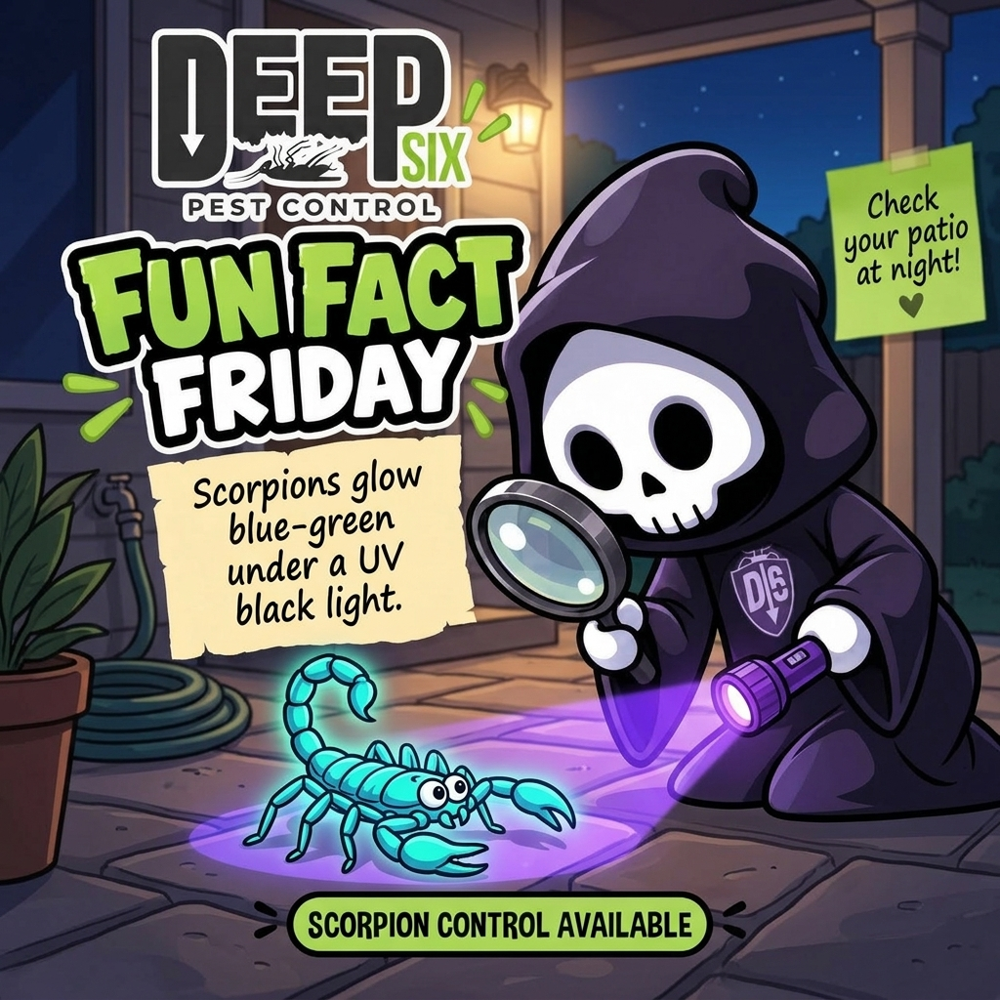
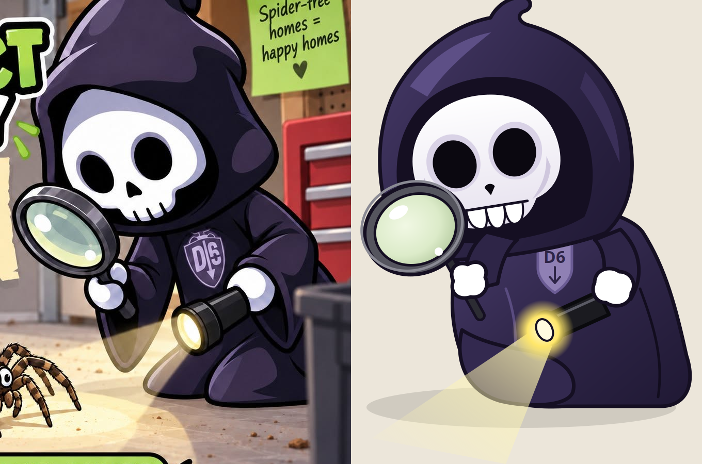
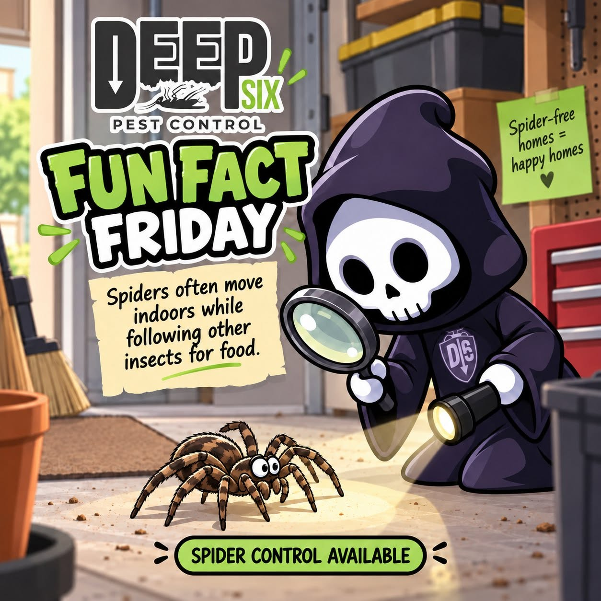

# Deep Six board

Newest on top.

---

### 2026-10-19 11:05 · Narration reset and video workflow

# How we make Deep Six videos

**The narration was scrapped October 19. We are still testing the writing method; no current ant video has been produced.** This record will supply the steps and decisions for a later flow diagram.

All videos: **9:16, Deep Six colors, cartoon animation made through code such as JavaScript or TypeScript.**

## Steps and current position

| ID | Step | What it produces | Current ant episode |
|---|---|---|---|
| V01 | Pick a homeowner problem and check previous sources | Episode ID, useful angle, unused factual source | Ant research done; ANT-S001 already logged |
| V02 | Extract supported facts and limits | Claim notes with source pages or timestamps | [Historical fact check](01-content/experiments/2026-10-16-ant-return-narration/source-check.md) saved |
| V03 | Write hooks; Drew chooses one | Selected hook and feedback | Hook 14 chosen for the old draft; no new selection |
| V04 | Draft the narration from that same factual source | Versioned script and exact writing prompt | Script scrapped; replacement not started |
| V05 | Review facts, natural speech, and context; revise | Checked script and Drew’s feedback | Writing method still unproven; spoken read not completed |
| V06 | Choose a cartoon reference and plan scenes | Verified production method, characters, brand palette, 9:16 storyboard | [References found](01-content/cartoon-animation-links.md); final style not chosen |
| V07 | Make the voiceover and measure its timing | Audio, voice settings, timestamps | Planned; voice tool not chosen |
| V08 | Write the animation code and render a sample | Saved code, visual assets, short 9:16 preview | Planned; rendering tool not chosen |
| V09 | Review and revise the video | Checks for facts, character action, captions, timing, sound, and brand | Planned |
| V10 | Export and review the finished video | 1080 × 1920 file, source credits, final feedback | Planned |
| V11 | Publish after Drew authorizes it | Platform links and publication date | Planned; no posting authorized |

For the later diagram: a rejected hook returns to V03; narration feedback returns to V04; video feedback returns to the affected scene, audio, or code step. Style research can happen alongside writing. Storyboarding needs both the script and the chosen style.

## How we are developing narration

- Audience: one homeowner with a real pest problem. Explain one useful point and a practical next step.
- Choose the hook first. Develop the rest from the same factual source. Keep writing/style examples separate from pest facts.
- Save the exact prompt and every draft. Use specific feedback to revise the wording; keep rejected versions for comparison.
- Explain what is happening before recommending an action. Drew rejected “before you start trimming” because the script had not established why trimming was relevant.
- Use connected, everyday speech. Drew rejected earlier versions as unnatural. A written editing pass is recorded separately from an actual spoken read.
- Check revised claims against the source. Record the source immediately, even if the draft is later scrapped.
- The next method test still needs an approved voice example or actual feedback on a new draft. No narration template has earned approval yet.

Methods investigated: [n8n scripting prompts](01-content/research/n8n-narration-prompts-2026-10-16.md) and [narration-writing repositories](01-content/research/narration-writing-repos-2026-10-16.md). Ideas were combined in a [trial prompt](01-content/experiments/2026-10-16-ant-return-narration/narration-prompt-trial.md). No n8n workflow or repository automation was installed or run.

## Record each attempt

For each step, record the date, episode and step ID, input/source links, tool/model if known, exact prompt or settings, output version, checks performed, Drew’s feedback, next action, and cost if any. Mark unknown details as unknown. Keep planned steps separate from completed ones.

## Progress history

| Date | Steps | Work and outcome |
|---|---|---|
| October 16 | V01–V03 | Ant homeowner research; ANT-S001 logged for D6-ANT-001. Two hook rounds; Drew selected 14: “That branch touching your house? Ants can use it as a bridge.” |
| October 16 | V04–V05 | Several drafts and a full rewrite. Researched n8n and writing repositories, saved a trial prompt, and applied writing/editing ideas. Feedback: unnatural voice and missing context before the trimming advice. No approved voice example or measured spoken read. |
| October 16 | V06 | Found cartoon references. Ant colony has published JavaScript but is widescreen; the two vertical animal cartoons have unverified code methods. No reference yet meets every requirement with verified evidence. |
| October 19 | V04–V05 | Scrapped the narration. [Final old draft archived](01-content/experiments/2026-10-16-ant-return-narration/narration-scrapped-2026-10-19.md); earlier drafts preserved. No replacement written. ANT-S001 stays in the [source log](01-content/source-log.md). |
| October 19 | All | Started this process record for the future diagram. Downstream steps remain plans. No diagram made yet. |

### 2026-10-16 23:18 · Cartoon animation — closer matches

# Cartoons closer to our Deep Six videos

**Required method: AI writes animation code, such as JavaScript or TypeScript. Every Deep Six video must be 9:16 vertical.**

The ant colony below has published JavaScript drawing and animation code. The two vertical cartoons match the look, but their exact implementation is unverified. For ours, the action would show an ant reaching a house while the narration explains the homeowner’s next step.

## 1. Animals sneaking snacks — closest character style

[Watch the cartoon](https://x.com/jackfriks/status/2103525576912855363)

A pig, pug, and duck sneak snacks after the cat goes to bed. Expressive animal characters, rooms, props, and a visual joke.

**35 seconds · 9:16 · September 25, 2026.** The creator credits Opus 5.5; JavaScript/TypeScript implementation is unverified. This is comedy; we would borrow the character acting and scene style for our lesson.

## 2. Mailbox love notes — simple cartoon story

[Watch the cartoon](https://x.com/jackfriks/status/2103132260589338762)

Cute animals, painted scenery, a mailbox, and large captions. A useful reference for one character doing something easy to follow.

**20 seconds · 9:16 · September 24, 2026.** The creator says Opus 5.5 animated supplied app artwork. The exact animation implementation is unverified. This is an app promo; the artwork was already provided.

## Animated ant colony — confirmed JavaScript example; widescreen reference

[Watch the ant animation](https://x.com/hanifproduktif/status/2102742924148830211) · [Published animation code](https://github.com/buildwithhanif/claude-animation-skill/tree/main/examples/ant-colony)

Illustrated ants cut and carry leaves, then the scene follows them underground. The creator published the JavaScript that draws and animates them.

**32 seconds · September 23, 2026. This reference is 16:9 widescreen.** We would need to rebuild the scene layout for **9:16**, which remains required for every Deep Six video.

This is a leafcutter-ant showcase, so it is a visual reference only. Our pest advice still comes from our logged educational source.

### 2026-10-16 22:38 · Educational AI animation — watch links

# Educational AI animation styles

The finished examples we found, with the photon video first.

**All Deep Six videos must be 9:16 vertical.**

## Journey of a Photon — your pick

Playful character, visual jokes, and a journey through space.

[Watch the video](https://x.com/AstroTheWizard/status/2103629247751618782) · [Read the animation prompt](https://github.com/yihui-dev/awesome-opus5-5-videos/blob/main/prompts/astrothewizard-618782.md) · [Alternative watch page](https://skillry.dev/ai-videos/opus-5-5/astrothewizard-618782)

## Chemistry — colorful moving diagrams

Atoms, molecules, and mixtures explained with simple shapes and labels.

[Watch the video and read how it was made](https://www.reddit.com/r/ClaudeAI/comments/1wr268d/a_different_kind_of_opus_55_video_prompt/)

## Recursion — cartoons and visual jokes

One concept explained through several playful animation styles.

[Watch Ethan Mollick’s video](https://x.com/emollick/status/2103688362960019567)

## A tree as an ecosystem — illustrated cutaway

A tree, animals, fungi, and roots shown as a connected environment.

[Watch hunzai’s video](https://x.com/hunzai/status/2103904436141842605)

## Eye evolution — animated science diagrams

Cross-sections, light rays, and labels explain a biological process.

[Watch Çağrı Mert Bakırcı’s video](https://x.com/cagrimbakirci/status/2104011756397842869)

## The Bitter Lesson — educational music video

A lesson told through a song and animated visuals.

[Watch on YouTube](https://www.youtube.com/watch?v=OAwat51S_Sk) · [Creator’s production notes](https://www.oneusefulthing.org/p/the-dot-and-the-swarm)

## How Laya Works — technical explainer

A longer lesson using mathematical animation and narration.

[Watch on YouTube](https://www.youtube.com/watch?v=obR9DYQq3v4) · [Creator’s production notes](https://www.hijoseromero.com/posts/opus-55-made-three-ai-learning-videos)

## More examples and prompts

[Browse the Opus animation collection](https://github.com/yihui-dev/awesome-opus5-5-videos)

### 2026-10-16 22:37 · Ant bridge — full rewrite

**The branch ants use as a bridge**

*Narration · full rewrite · draft for feedback*

That branch touching your house? Ants can use it as a bridge.

An ant can walk out along that branch and step straight onto your roof. If it finds a crack leading inside, it’s in.

That’s why keeping trees trimmed is part of keeping ants out. Walk around the house and check for branches touching the roof or walls.

Trim those back so they no longer touch. You’re removing a way for ants to reach the house.

---

Source: [Managing Household Ant Pests — Texas A&M](https://extensionentomology.tamu.edu/wp-content/uploads/sites/6/2021/03/managing-household-ants.pdf).

### 2026-10-16 22:35 · Ant bridge — trimming context fixed

**The branch ants use as a bridge**

*Narration · new take · draft for feedback*

That branch touching your house? Ants can use it as a bridge.

Say you’ve got ants in the kitchen. You wipe them up, and the next morning there’s another line of them.

Take a look at the tree beside the house. If a branch touches the roof, ants can walk right across. A crack in the house may be all they need to get inside.

If you see ants crossing that branch, watch where they go. They might lead you to the crack they’re getting through.

Cutting the branch back so it no longer touches the house takes away that bridge. Seal the crack they’ve been using, too.

---

Source: [Managing Household Ant Pests — Texas A&M](https://extensionentomology.tamu.edu/wp-content/uploads/sites/6/2021/03/managing-household-ants.pdf).

### 2026-10-16 21:56 · Ant bridge — new narration take

**The branch ants use as a bridge**

*Narration · new take · draft for feedback*

That branch touching your house? Ants can use it as a bridge.

Say you’ve got ants in the kitchen. You wipe them up, and the next morning there’s another line of them.

Take a look at the tree beside the house. If a branch touches the roof, ants can walk right across. A crack in the house may be all they need to get inside.

Before you start trimming, see if ants are actually using that branch. If they’re crossing over, watch where they go. They might lead you to the crack they’re getting through.

Then trim the branch away from the house and seal that crack.

---

Source: [Managing Household Ant Pests — Texas A&M](https://extensionentomology.tamu.edu/wp-content/uploads/sites/6/2021/03/managing-household-ants.pdf).

### 2026-10-16 20:51 · Trial prompt for natural narration

**Deep Six narration prompt — trial**

Write a short, useful voiceover for Deep Six Pest Control. Your listener is one homeowner dealing with a pest problem.

Use the selected hook and the supplied factual source. If a voice example has been approved, study its rhythm, transitions, and humor. Write fresh wording; get every pest claim from the factual source.

Sound like someone standing beside the homeowner, pointing out what's happening. Use everyday words, contractions, and a mix of short and longer sentences. Let each thought lead into the next.

Keep the selected hook exactly. Develop one useful observation: what's happening, why it matters, and what the homeowner can do. Spend the words on explaining that connection. Stop when the useful point is complete.

Name things the homeowner can see. Replace vague phrases with the actual place, object, or action. Keep the spoken voice warm and direct. Avoid a string of clipped instructions, forced jokes, canned suspense, and a sales ending.

Keep the source's uncertainty and limits. Use only supported facts. Personal experiences and customer stories require real supplied details.

Before returning the draft, check the wording as speech. Rewrite anything that sounds like a brochure, report, or checklist. Remove repeated ideas and lines added only to fill time.

Apply the supplied editing notes to the actual wording. Treat approved examples as the voice target; treat rejected drafts as examples of what needs to change.

Return the narration as short paragraphs. Put the source credit separately, outside the spoken script.

### 2026-10-16 20:48 · Ant bridge — narration draft

**The branch ants use as a bridge**

*Narration · selected hook 14 · about 45 seconds*

That branch touching your house? Ants can use it as a bridge.

A branch can get them onto the roof. From there, a small gap may give them a way inside.

So if ants keep turning up indoors, check what’s touching the outside. Tree limbs, shrubs against the siding, vines growing up the wall.

Watch for ants at those contact points. Follow any trail you find—it can help you spot where they’re getting in.

Trim the vegetation back from the house, and seal small entry gaps.

That blocks a route. If ants are already nesting inside, the nest still needs attention.

---

Source: [Managing Household Ant Pests — Texas A&M](https://extensionentomology.tamu.edu/wp-content/uploads/sites/6/2021/03/managing-household-ants.pdf).

### 2026-10-16 20:11 · More ant hooks — 9 through 18

**More ant hooks**

9. Why do the ants keep showing up in the exact same spot?

10. You cleaned up the food. Did you check for water?

11. That line of ants is leaving you clues.

12. A clean kitchen can still have an ant problem.

13. Before you treat the whole house, find out where the ants are nesting.

14. That branch touching your house? Ants can use it as a bridge.

15. Rain outside. Ants inside. There may be a connection.

16. If the ants ignore your bait, adding more may not solve it.

17. You’ve found the ants. Now find what they’re after.

18. The gap where ants get in isn’t necessarily where they live.

---

Same source: [Managing Household Ant Pests — Texas A&M](https://extensionentomology.tamu.edu/wp-content/uploads/sites/6/2021/03/managing-household-ants.pdf).

### 2026-10-16 20:09 · Ant video — pick the hook first

**Ant video — hook options**

1. You cleaned the kitchen. The ants came back. Now what?

2. Before you wipe up that ant trail, see where it’s going.

3. What if the ants aren’t coming from outside?

4. Killing the ants on your counter might leave their nest untouched.

5. No crumbs. No spills. So why are there ants in your bathroom?

6. Ants walking right past your bait? You might be offering the wrong food.

7. Sometimes an ant problem starts with a plumbing problem.

8. Before you buy another ant treatment, find out which ant you have.

---

Same source: [Managing Household Ant Pests — Texas A&M](https://extensionentomology.tamu.edu/wp-content/uploads/sites/6/2021/03/managing-household-ants.pdf).

### 2026-10-16 19:25 · Why the ants keep coming back — narration draft

**Why the ants keep coming back**

*Narration · first draft · about 50 seconds*

You wiped up the ants yesterday. Today, they’re back on the same counter.

That can happen when you remove the workers but leave their nest untouched.

Before cleaning up the next trail, watch where it goes. Check along the wall and around pipes. You may spot where they’re getting in.

Then check what they’re after. Seal up open food, clean up spills, and look under the sink for leaks. Ants need water, too.

If they keep coming back, get the ant identified before choosing a treatment. Different species can need different approaches.

And if reaching the nest would mean opening a wall, leave that to a professional.

---

Source: [Managing Household Ant Pests — Texas A&M](https://extensionentomology.tamu.edu/wp-content/uploads/sites/6/2021/03/managing-household-ants.pdf).

### 2026-10-16 15:16 · Scorpion fun fact, AI image, 3 cents

### 2026-10-16 14:46 · Reaper drawn in code (right) vs original

### 2026-10-16 14:46 · Original Deep Six post

